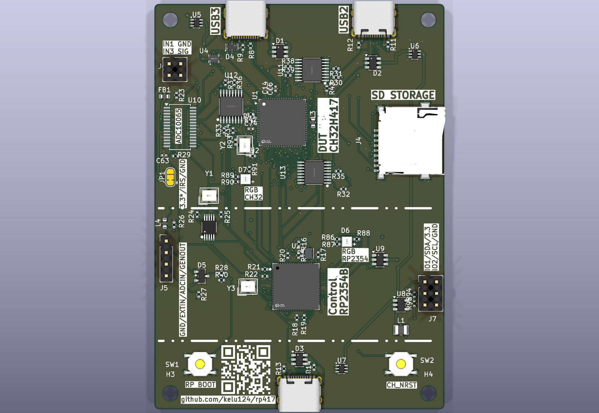
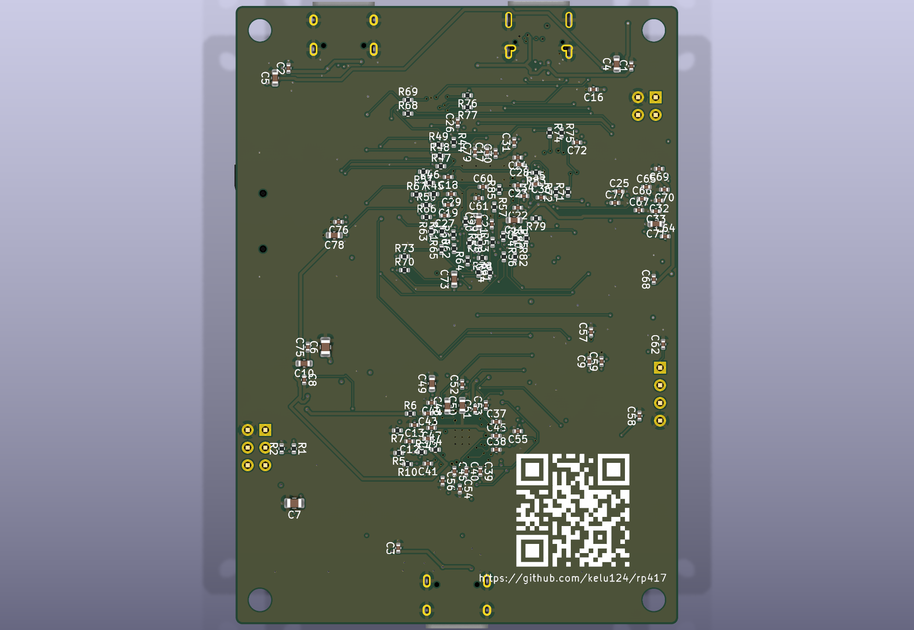
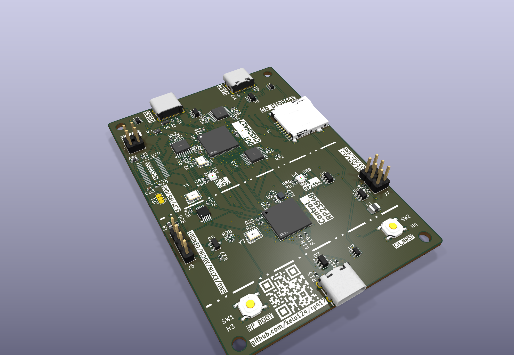

# rp417

RP2350 x CH32H417 — a dev/test board on which an **RP2354B** (RP2350 family) supervises a
**WCH CH32H417MEU6** (QFN88). The RP2350 powers, resets, programs, stimulates and measures the
CH32 so that a PC script can run automated limit tests on it: USB3 throughput, parallel ADC
capture, the CH32's internal ADC/HSADC, and microSD (SDIO). Both chips have their own USB port to
the host, and the board also works with no host on the RP2350's USB (CH32 standalone).

KiCad, 6 layers, 63.5 × 88.9 mm (playing-card size), parts on both sides, built for JLCPCB
fab + assembly. **Rev A is fully routed**; production files exist and the BOM is being finalised.

| Top | Bottom |
|---|---|
|  |  |

## What's on the board

- **DUT: CH32H417MEU6** (QFN88, 10 × 10 mm, 0.4 mm pitch, D54). User-supplied and consigned to
  JLC for assembly (D43, D58). Internal LDO makes the core rails — no external 1V2 (D25).
- **Supervisor: RP2354B** (RP2350B + 2 MB in-package flash, D24), always powered. Controls the
  CH32 power domain and NRST, programs the CH32 over SDI as a ch32fun/minichlink "funprog"
  programmer (D11), and talks to it over UART, I2C, QSPI (CH32 master, RP PIO slave, D38) and an
  8-line GPIO logic bus. Monitors the CH32 3V3 rail and VSYS with its own ADC (D28).
- **Power tree (D25, D41):** J1/J2/J3 VBUS ORed by 3 × LM66100 ideal diodes → VSYS 5 V → one
  always-on 3V3 buck (TLV62569) → RP2354B, Si5351A, TS3USB221A; plus an RP-controlled
  CH32-domain load switch (TPS22918, quick output discharge, default ON) → CH32, microSD,
  ADC10065, capture switches. Any one USB cable powers the whole board.
- **Back-feed protection (D29):** no bus-isolation ICs. The RP firmware tri-states every line and
  disables the Si5351 outputs before switching the CH32 domain off; series resistors on every
  RP↔CH32 and clock line, I2C pull-ups on the CH32 rail, open-drain NRST, PB8/PB9 isolated by
  the USB switch, Ioff capture switches.
- **USB (D02, D27, D45):**
  - J1 — CH32 USB3 USB-C (SuperSpeed + USBHS D+/D−). SS pairs wired for one plug orientation:
    one way round gives USB3, flipped gives USB2 only.
  - J2 — CH32 USBFS USB-C (PA11/PA12, also the USB ISP port).
  - J3 — RP2354B USB-C.
  - USBLC6-2SC6 ESD on all D± pairs, RClamp0524P on the J1 SS pairs.
  - TS3USB221A on PB8/PB9 selects USB connector (default) or RP SWD — those pins are both USBHS
    and the CH32 debug pins (D14, D26). Doubles as a software "unplug".
- **Clocks (D32):** Si5351A-B-GTR (genuine, D46): CLK0 = ADC10065 clock, CLK1 = DVP PCLK
  (phase-tunable, same PLL), CLK2 = test-signal generator.
- **Generator + LC filter (D31, D33):** Si5351 CLK2 → 50 Ω → 5th-order Butterworth low-pass,
  fc ≈ 30 MHz → roughly 1.5–2 Vpp sine (estimate, to bench-verify). Clean sine around
  10–30 MHz; a shaped square below. Intended for throughput tests, not signal fidelity (D05).
- **Capture path (D55, D57):** ADC10065 (10-bit, 65 MSPS) → 3 × SN74CBTLV3257 2:1 switch → CH32
  DVP (D0–D9 + PCLK on PB12). The switch (RP GPIO42 `CAP_SEL`, default = ADC) can instead feed
  a 10-bit counter pattern from the RP PIO, to check exactly for lost, duplicated or reordered
  samples. The ADC10065 is **DNP**: footprint and passives are fitted, the user hand-solders the
  part (D42). Its input range is set on solder jumper JP1 (default 2 Vpp, D44).
- **Analog input select J5 (D34):** 1×4 header GEN | ADC_IN | EXT | GND — jumper 1–2 =
  generator, 2–3 = external input (49.9 Ω terminated, clamped). GEN + GND doubles as a scope probe
  point. ADC_IN also feeds the CH32 ADC + HSADC on PC0 (D35).
- **HSADC test header J6 (D64, D65):** 2×2 — 1 PC1 (HSADC_IN1) via 100 Ω · 2 GND · 3 PC3
  (HSADC_IN3) via 100 Ω · 4 GEN_OUT.
- **SAO header J7 (D66):** 2×3, SAO v1.69bis pinout, on RP I2C0 (GPIO44 SDA / GPIO45 SCL),
  4.7 kΩ pull-ups, VCC = always-on +3V3. Pins 5/6 not connected.
- **Status LEDs (D62, D63, D66):** two RGB LEDs, D6 on the RP2354B and D7 on the CH32.
- **microSD (J4, D04):** TF-01A slot on the CH32 SDIO/SDMMC.
- **Buttons (D51):** CH32 RESET and RP2350 BOOTSEL.
- **Not on rev A:** UHSIF capture (parked, D21), external power input (D41), current monitoring
  (D28), on-board WCH-LinkE (D10).

## Gotchas worth knowing

See `SPEC.md` §3 for the sources.

- **No BOOT0 pin.** The CH32 enters its bootloader by power-cycle: USB ISP on USBFS (DP high +
  DM low at power-on), or "key-free" UART ISP on **PA9/PA10** (QFN88). Controlling CH32 power is
  itself the fallback programming mechanism.
- **SWD/SDI pins PB8/PB9 are the USBHS D+/D− pins** — hence the TS3USB221A switch.
- **Package:** BOOT/ISP is available on QFN128 and QFN88, not on QFN68 (WEU). QFN88 lacks some
  pins (PE2, PE7, PF13, PA6, PA8, PB6, PB7, VREFP, VBAT) and has only HSADC_IN0–3 and one PCLK
  pin (PB12).
- **Lot number:** older datasheet versions said parts with lot digit 5 = 0 lack some peripherals;
  V1.9 no longer says so, but the EVB reference still says WCHISPTool needs digit 5 ≠ 0. Check
  on receipt.
- **Power-off order:** before switching the CH32 domain off, the RP firmware must tri-state its
  lines and stop the Si5351 outputs (D29) — the hardware relies on this plus series resistors.
- **Still to prove on hardware:** gapless continuous DVP capture, funprog flashing of the H41x,
  generator amplitude, CH32 temperature at full USB3 load, and the RP2350 I2C pin mapping used
  for J7.

## Repository layout

| Path | What |
|---|---|
| `SPEC.md` | Living specification — the main reference for the design. |
| `DECISIONS.md` | Append-only log of every design decision (D01–…), with rationale and alternatives. |
| `hw/` | KiCad project (schematic sheets, `rp417.kicad_pcb`), generators in `hw/gen/`, LCSC library and 3D models in `hw/lib/`, renders in `hw/renders/`. See [`hw/README.md`](hw/README.md). |
| `hw/production/` | Gerber zip (`rp417.zip`), BOM (`bom.csv`), placement (`positions.csv`), IPC netlist. |
| `docs/design/` | Block diagrams, pin plans, BOM and area budget (`block-diagram.html`), plus proposal tables. |
| `datasheets/` | Datasheets as PDF and their markdown translations (for grepping and citing). |
| `projects/` | List of CH32H417 reference repos (hardware/sdk/firmware/tools) and `clone.sh`; the clones are gitignored. |
| `userinputs/` | Raw notes — unverified until checked against datasheets. |

## Building / regenerating

The schematic is generated from code (`hw/gen/build.py` is the netlist source of truth, D49);
the placement and plane fan-out come from `hw/gen/pcb.py`. Since D61 the PCB is hand-routed in
KiCad and the generators no longer overwrite it. Rebuild steps, stack-up and 3D-model notes are in
[`hw/README.md`](hw/README.md).

## Status

- Rev A schematic and layout complete; routing finished by hand (D61).
- Production files are in `hw/production/`. **The BOM is not order-ready yet**: LCSC part
  numbers (mainly the JLC Basic passives) are still being assigned.
- No firmware in this repository yet. Next: RP2350 funprog port + test-control USB interface, and
  bring-up of the open hardware checks listed above. Open items: `.claude/TODO.md`.

## License

This work follows the licensing of the author's previous open-hardware projects
([pic0rick](https://github.com/kelu124/pic0rick), [the echOmods project](https://github.com/kelu124/echomods/),
the [un0rick project](https://doi.org/10.5281/zenodo.377054) and the
[lit3rick project](https://doi.org/10.5281/zenodo.5792245)).

Copyright Luc Jonveaux (<kelu124@gmail.com>) 2026

* The hardware is licensed under TAPR Open Hardware License (<www.tapr.org/OHL>) — see [`LICENSE.txt`](LICENSE.txt).
* The software components are free software: you can redistribute it and/or modify it under the terms of the GNU General Public License as published by the Free Software Foundation, either version 3 of the License, or (at your option) any later version.
* The docs are licensed under a [Creative Commons Attribution-ShareAlike 3.0 Unported License](http://creativecommons.org/licenses/by-sa/3.0/).

## Disclaimer

This project is distributed WITHOUT ANY EXPRESS OR IMPLIED WARRANTY, INCLUDING OF MERCHANTABILITY, SATISFACTORY QUALITY AND FITNESS FOR A PARTICULAR PURPOSE.
