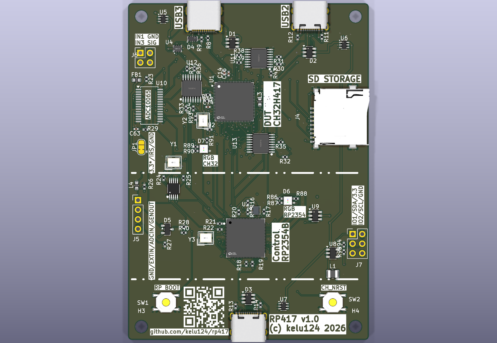
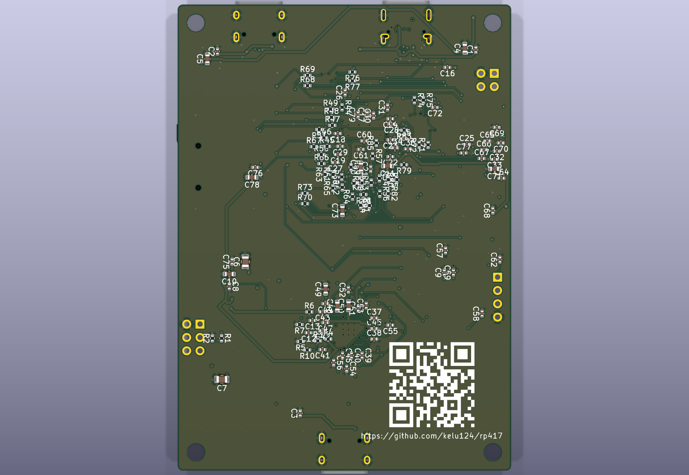
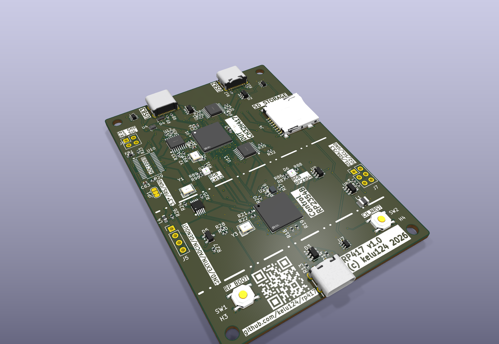
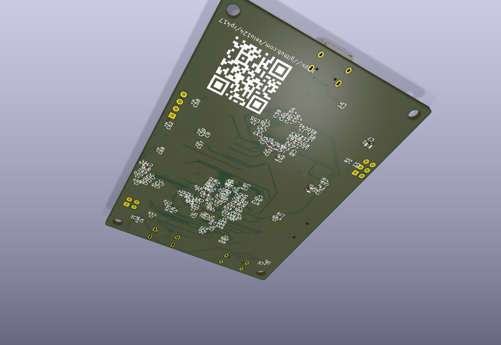
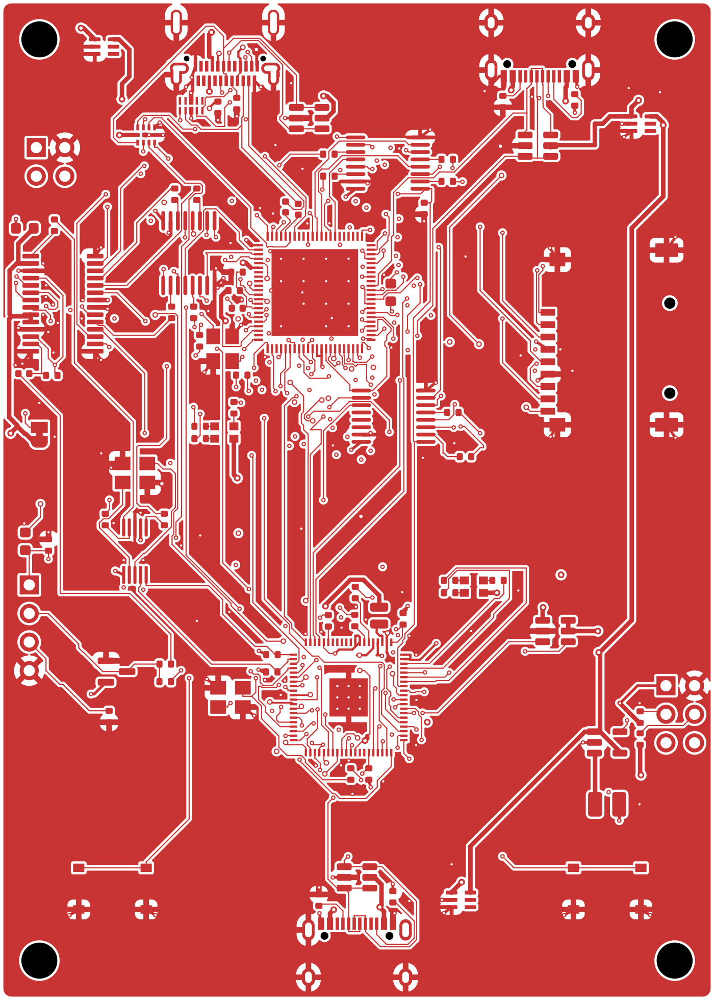
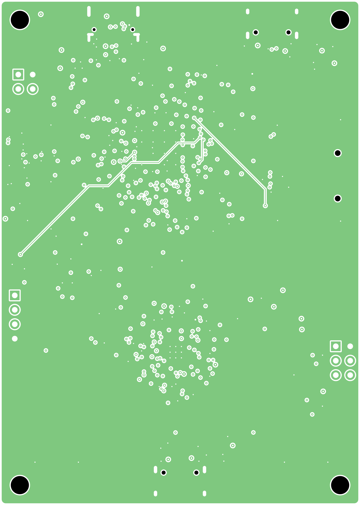
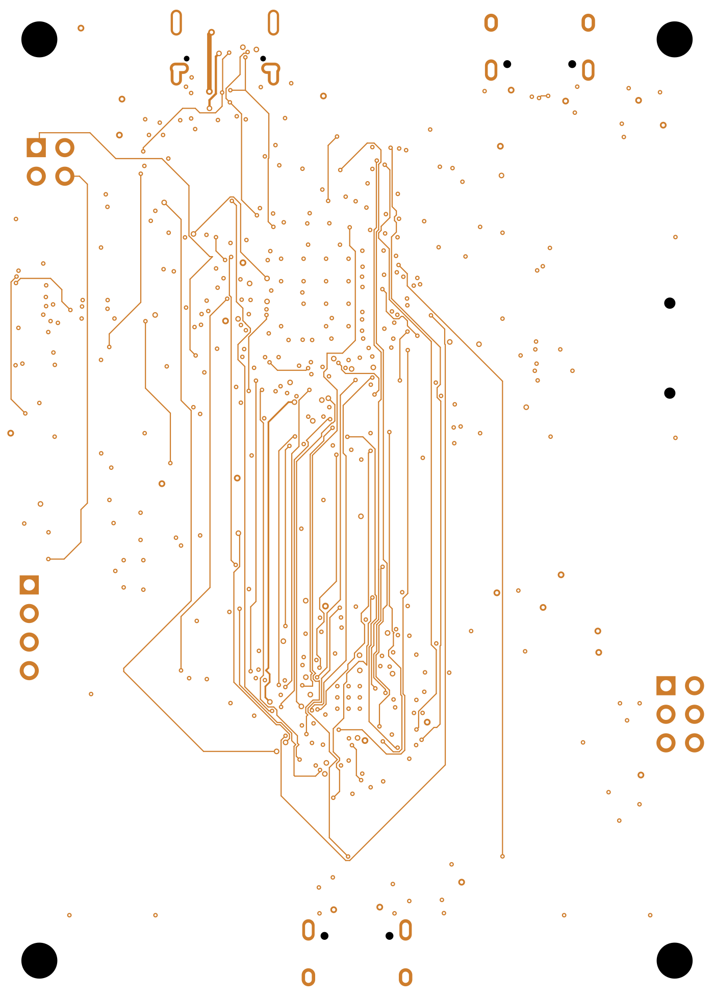
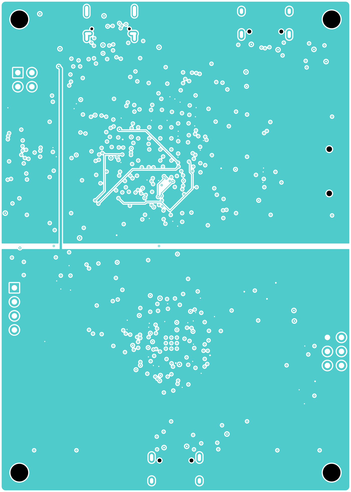
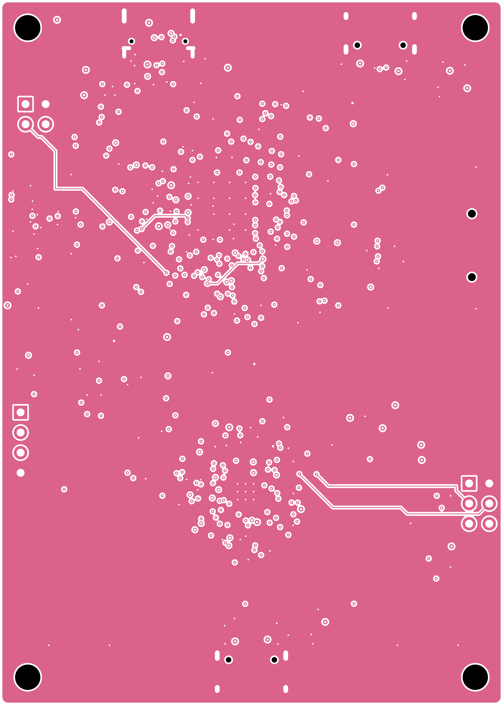
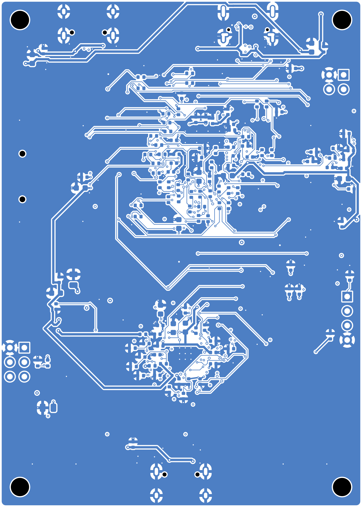

# Board images (v1.0)

Renders from `kicad-cli pcb render` of `hw/rp417.kicad_pcb` (commands in `hw/README.md`); layer plots and assembly
views written by `/usr/bin/python3 hw/gen/gen_site.py` (re-run after board changes).

| Top | Bottom |
|---|---|
|  |  |
|  |  |

Copper layers (board area; B.Cu mirrored as seen from below):

| F.Cu | In1 (GND) | In2 (signal) |
|---|---|---|
|  |  |  |

| In3 (+3V3_CH / +3V3) | In4 (GND) | B.Cu |
|---|---|---|
|  |  |  |

Assembly views (silkscreen + fab): [top](rp417-v1.0-assembly-top.png), [bottom](rp417-v1.0-assembly-bottom.png).
