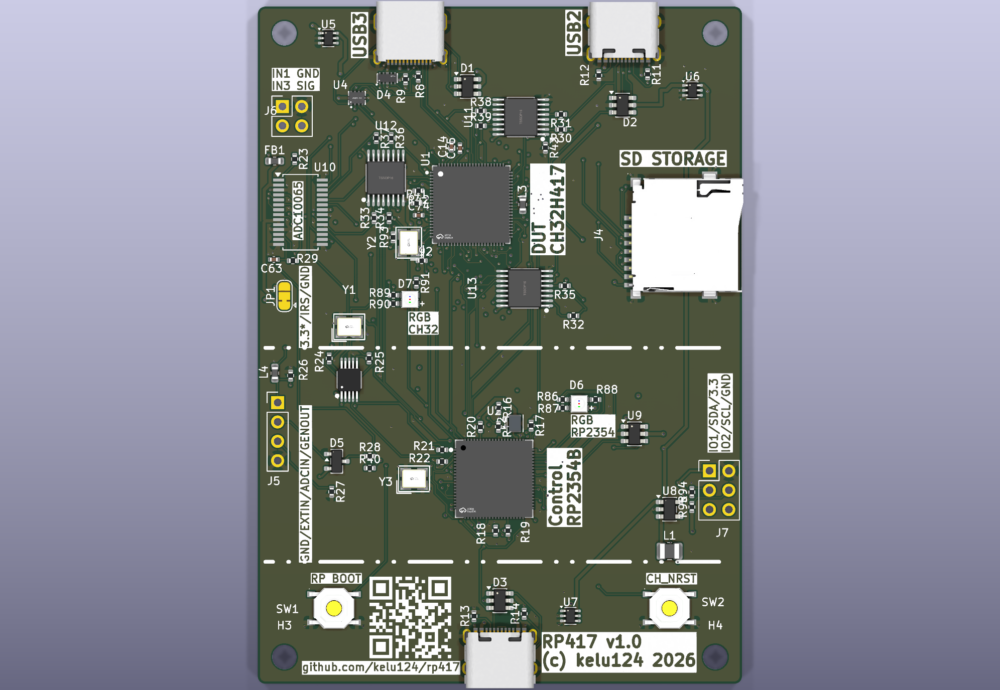
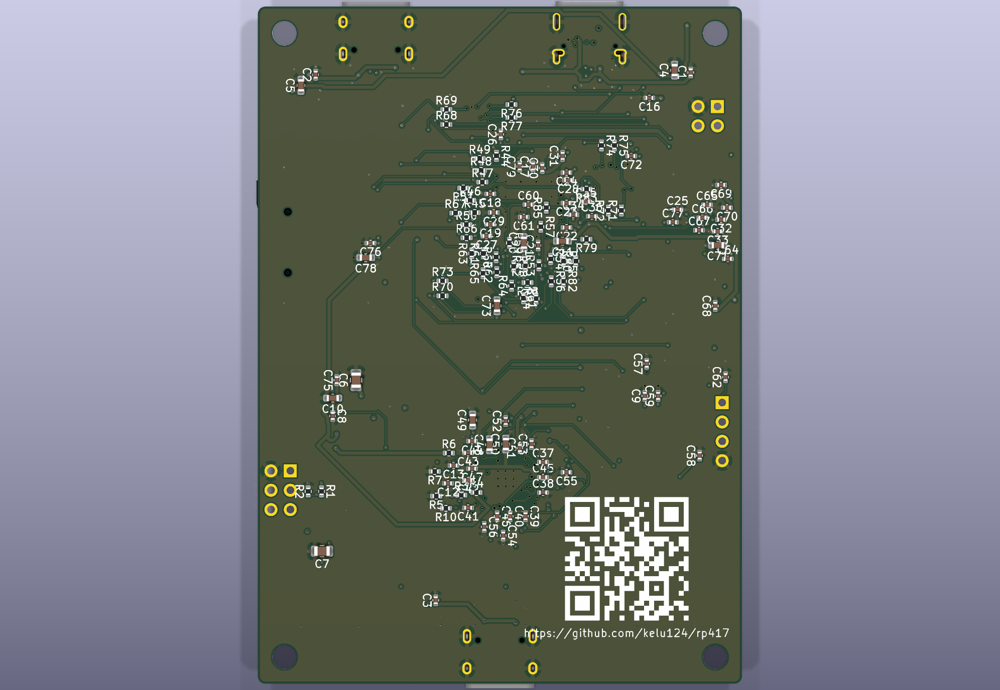
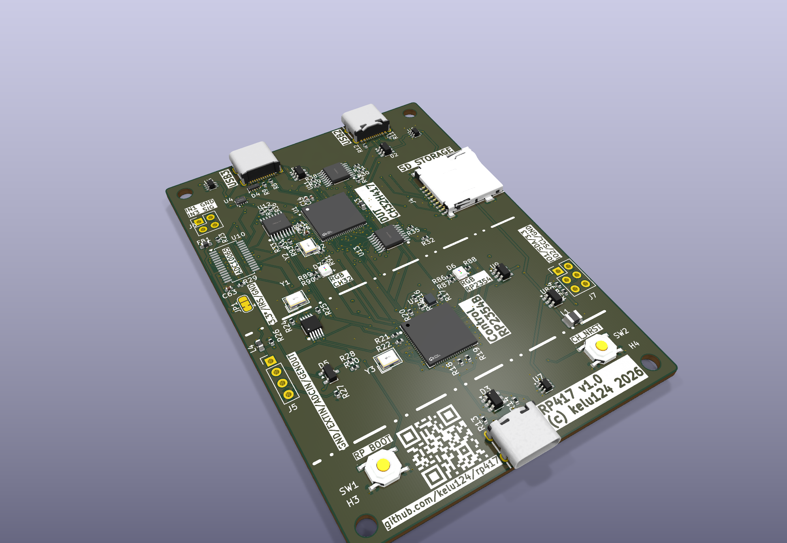

# rp417 — RP2354B × CH32H417, automated limit testing

An open-hardware board (KiCad) on which a **Raspberry Pi RP2354B** (RP2350 family) supervises a
**WCH CH32H417MEU6**. The RP2354B powers, resets, programs, stimulates and measures the CH32 so that a PC script
can run automated limit tests on it: **USB3 throughput**, **parallel ADC capture** (DVP), the CH32's **internal
ADC and HSADC**, and **microSD** (SDIO). Both chips have their own USB port to the host, and the board also works
with no host on the RP2354B's USB.

**Status: v1.0 (rev A)** — schematic complete, PCB fully routed by hand (6 layers, 63.5 × 88.9 mm, 0 unconnected),
JLCPCB production files generated with an LCSC number on every BOM line. Not fabricated yet; no firmware yet.
[Source on GitHub](https://github.com/kelu124/rp417).

| Top | Bottom |
|---|---|
|  |  |

## What it does

| Block | RP2354B (supervisor) | CH32H417MEU6 (device under test) |
|---|---|---|
| USB | USB 2.0 on USB-C J3 (test control, CH32 programmer) | **USB3 SuperSpeed** + USB2 HS on USB-C J1; USB FS on USB-C J2 (also USB ISP) |
| Storage | 2 MB flash in the package | microSD J4 on SDIO/SDMMC |
| Capture | 10-bit PIO counter pattern into the CH32 DVP (lost / duplicated sample check) | DVP 10-bit capture of an ADC10065 (65 MSPS) or of the RP counter |
| Analog | Si5351A clock + test-signal generator (5th-order LC filter, ≈ 28.6 MHz corner) | 12-bit ADC + 10-bit HSADC fed from the same stimulus; HSADC test header J6 |
| User I/O | RGB LED, BOOTSEL button, SAO header J7 (I2C0) | RGB LED, RESET button |
| Control | switches the CH32 power, drives NRST, selects the capture source and the USB/debug switch | — |

- **Inter-chip links**: UART, I2C, QSPI (CH32 master, RP PIO slave), an 8-line GPIO logic bus, HSYNC/VSYNC and a
  shot marker — every line with a series resistor.
- **Programming**: the RP2354B is a ch32fun / minichlink "funprog" programmer on the CH32's SDI pins (PB8/PB9,
  shared with USB HS through a TS3USB221A switch). Fallback: the CH32 bootloader, entered by power-cycling it.
- **Power**: any of the three USB-C ports powers the whole board (3 × LM66100 ideal diodes); one always-on 3V3 buck;
  the CH32 domain sits behind an RP-controlled load switch.

## Documentation

| Page | Content |
|---|---|
| [Architecture](architecture.md) | Blocks, inter-chip links, programming, capture path, standalone mode |
| [Pin map](pinmap.md) | Every RP2354B ↔ CH32 link and every pin of both chips (generated from the netlist) |
| [Power](power.md) | Power paths, ideal-diode ORing, CH32 load switch, rails, back-feed protection |
| [Layout and routing](layout.md) | How the KiCad files are generated, stack-up, placement, plane fan-out, routing |
| [Bill of materials](bom.md) | JLCPCB parts with LCSC numbers, consigned and DNP parts |
| [Production](production.md) | Ordering at JLCPCB: files, settings, checklist |
| [Images](images/) | 3D renders, copper layer plots, assembly views |
| [CH32H417 hardware notes](ch32h417-hardware-notes.md) | Facts from the CH32H417 datasheet and reference manual that shaped the design |
| [Design page](design/block-diagram.html) | Original block diagrams, pin plans, parts list and area budget (rev A design phase) |

Requirements and design decisions (R1–R10, D01–D69) are in
[`.claude/SPEC.md`](https://github.com/kelu124/rp417/blob/main/.claude/SPEC.md) and
[`.claude/DECISIONS.md`](https://github.com/kelu124/rp417/blob/main/.claude/DECISIONS.md).

## Downloads

| File | |
|---|---|
| [rp417.zip](https://github.com/kelu124/rp417/raw/main/hw/production/rp417.zip) | Gerbers + drill files (JLCPCB) |
| [bom.csv](https://github.com/kelu124/rp417/blob/main/hw/production/bom.csv) | Assembly BOM with LCSC part numbers |
| [positions.csv](https://github.com/kelu124/rp417/blob/main/hw/production/positions.csv) | Assembly placement (CPL) |
| [KiCad board](https://github.com/kelu124/rp417/blob/main/hw/rp417.kicad_pcb) | Routed v1.0 board (KiCad 10) |
| [KiCad schematic](https://github.com/kelu124/rp417/blob/main/hw/rp417.kicad_sch) | Generated schematic (root sheet + 6 sub-sheets) |

## How the design is made

The schematic is generated from one Python file, `hw/gen/build.py` (parts, footprints, LCSC numbers, pin→net map).
`hw/gen/pcb.py` places the parts (passives perpendicular to their IC pin) and fans power pads out to the planes;
Freerouting gave a first draft, and the board was then routed by hand in KiCad. `hw/gen/gen_site.py` regenerates
this site's images, pin map and BOM page. Details: [Layout and routing](layout.md).

## References

- [CH32H417 datasheet and reference manual](https://www.wch-ic.com/products/CH32H417.html) (WCH);
  markdown copies in [`datasheets/`](https://github.com/kelu124/rp417/tree/main/datasheets).
- [ch32fun](https://github.com/cnlohr/ch32fun) — minichlink and the funprog programmer core.
- [RP2350 datasheet](https://datasheets.raspberrypi.com/rp2350/rp2350-datasheet.pdf) and
  [hardware design guide](https://datasheets.raspberrypi.com/rp2350/hardware-design-with-rp2350.pdf).
- [Freerouting](https://github.com/freerouting/freerouting), [easyeda2kicad](https://github.com/uPesy/easyeda2kicad.py).
- Sister project: [rp569](https://kelu124.github.io/rp569/) (RP2350B × CH569, USB 3.0 for PIO).

## License

Copyright Luc Jonveaux 2026. Hardware: [TAPR Open Hardware License](https://github.com/kelu124/rp417/blob/main/LICENSE.txt);
software: [GPL v3 or later](https://www.gnu.org/licenses/gpl-3.0.html);
docs: [CC BY-SA 3.0](http://creativecommons.org/licenses/by-sa/3.0/) — same terms as
[rp569](https://github.com/kelu124/rp569) and [pic0rick](https://github.com/kelu124/pic0rick).
