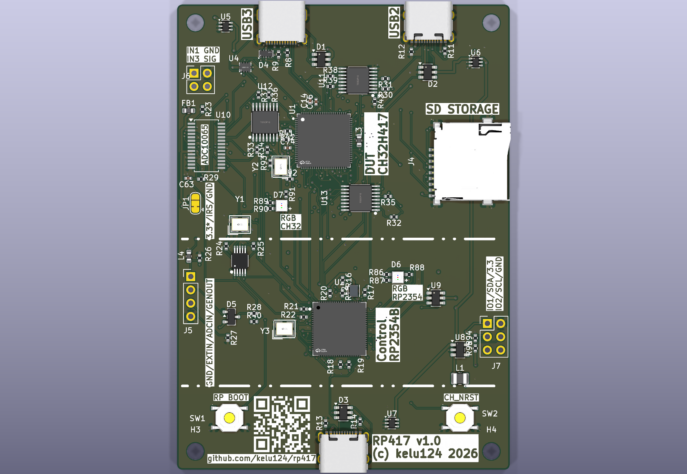
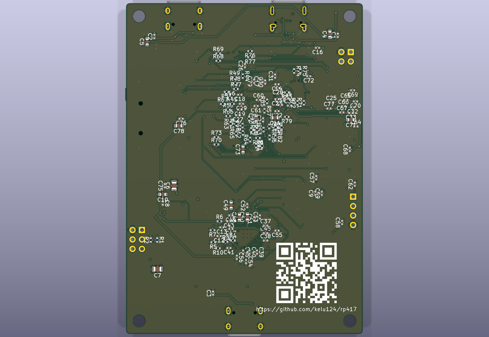
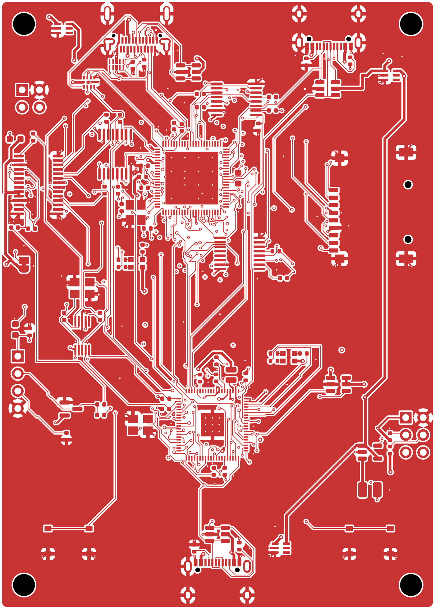
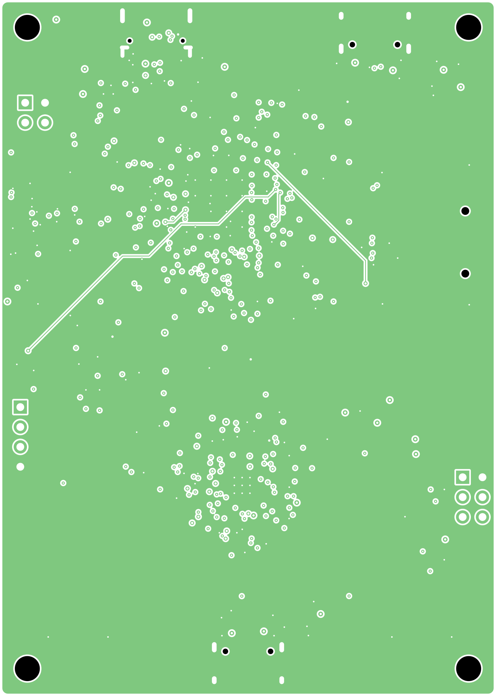
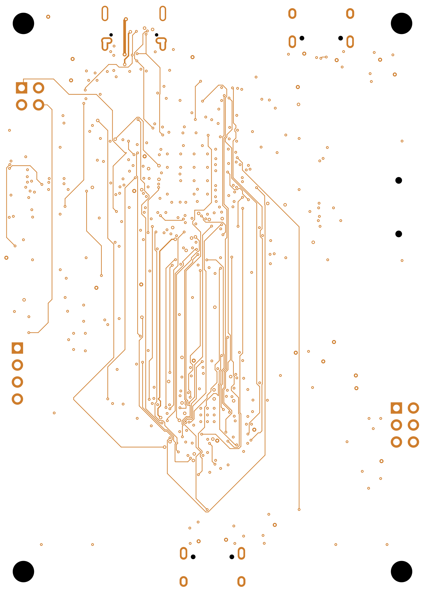
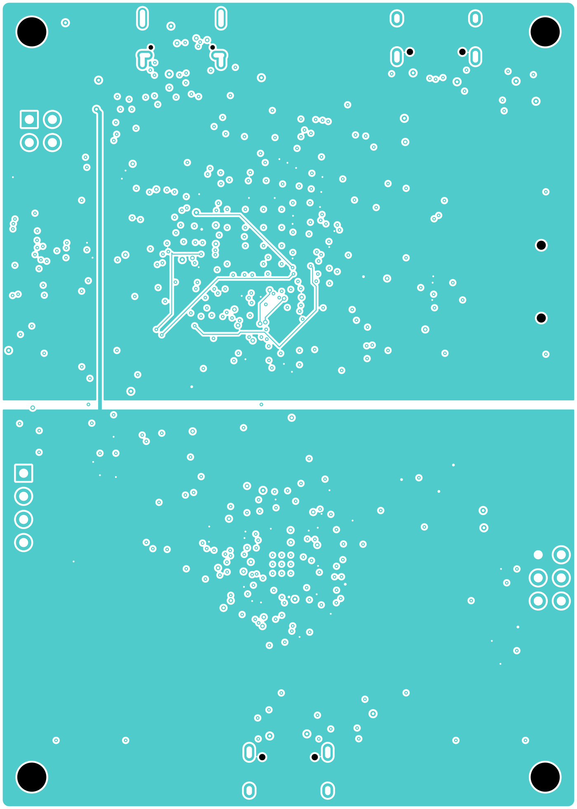
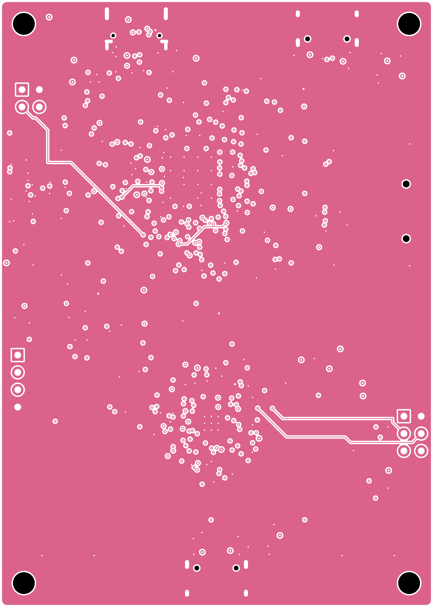
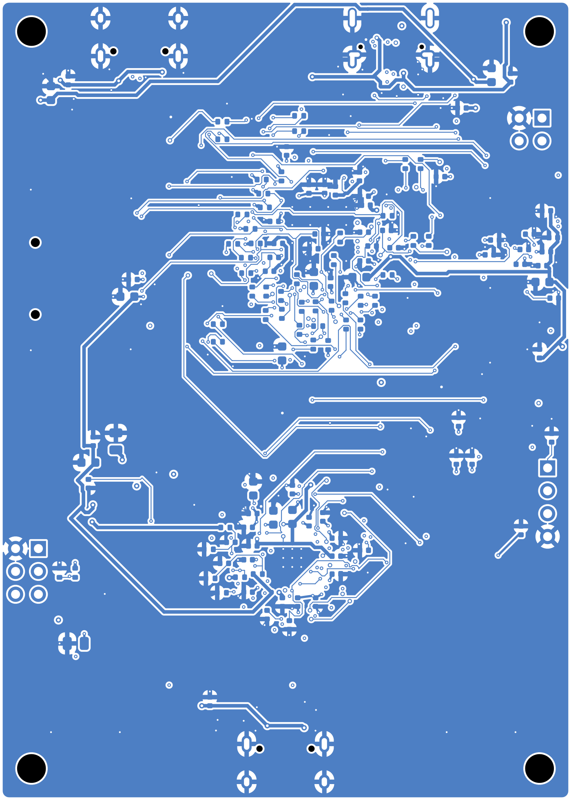

# Layout and routing

Status: **v1.0 (rev A), 2026-11-14 — fully routed by hand, 0 unconnected.** Remaining DRC items are known and
reviewed: 21 waived errors inside the USB-C connector footprints (D59), silkscreen flags from the QR codes, and
23 starved thermal reliefs to review before ordering.

| Top | Bottom |
|---|---|
|  |  |

## Board

- 6 layers, **63.5 × 88.9 mm** (playing-card size, D19), JLCPCB fab and assembly (D18).
- Parts on both sides (D48): connectors, ICs, crystals, analog and ESD on top; decoupling, series-R groups, bias
  networks, ideal diodes and the load switch on the bottom.
- Stack-up: F.Cu signal · In1 GND · In2 signal · In3 power (+3V3_CH top / +3V3 bottom) · In4 GND · B.Cu signal.
- Net classes: Default 0.1 mm track / 0.1 mm clearance, via 0.4/0.2 mm; Power 0.4 mm.

## How the KiCad files are produced

| Script | Output |
|---|---|
| `hw/gen/build.py` | **Netlist source of truth**: every part, value, footprint, LCSC number and net → the schematic (root + 6 sheets) and `nets.json` |
| `hw/gen/kisch.py` | Minimal schematic writer: each pin gets a stub and a global label (a netlist, not a drawing) |
| `hw/gen/pcb.py` | Footprints, placement, zones, plane fan-out → `hw/build/rp417_placed.kicad_pcb` + a Specctra DSN |
| `hw/gen/finish.py` | Imports a Freerouting session, fills zones, runs DRC (never overwrites the hand-routed board, D61) |
| `hw/gen/gen_site.py` | This site's images, pin map and BOM page |

Late changes after hand routing started (LEDs, test headers, SAO header) were added **at the end** of `build.py`, so
no existing reference is renumbered, and placed directly in the routed board.

## Placement rules

- Fixed anchors for connectors, ICs and crystals; the CH32 sits near J1 (USB3), the RP2354B in the lower half.
- **Passives tied to an IC pin are placed perpendicular to that IC edge, with the IC-side pad facing the pin**
  (D53); decoupling capacitors one per power pin, on the bottom under or next to it.
- Capture switches next to their DVP pin groups (D57): U11 top edge, U12 left edge, U13 bottom edge of the CH32.

## Plane fan-out (D60)

Generated before routing: a locked 0.4/0.2 mm via with a 0.25 mm stub ("dogbone") on every SMD pad of GND, +3V3
and +3V3_CH, placed away from the nearest QFN; a 4 × 4 via grid in the CH32 exposed pad and 3 × 3 in the RP2354B
pad; the QFN power pins reach their plane through their decoupling capacitor.

## Routing

1. **Freerouting 2.1.0** gave a first draft (60 → 26 open connections after the fan-out). Gotcha: headless, it
   ignores `-mp` / `--router.max_passes` and only saves its session when it finishes — use
   `--router.job_timeout` to stop it cleanly (details in
   [`hw/README.md`](https://github.com/kelu124/rp417/blob/main/hw/README.md)).
2. **Hand routing in KiCad** finished the board (D61), including the late additions.

Things the autorouter could not control and that were reviewed by hand: the USB3 SuperSpeed pairs (J1 ↔ CH32), the
USB HS/FS pairs, the crystals, PCLK and the DVP bus.

## Copper layers

| F.Cu | In1 (GND) | In2 (signal) |
|---|---|---|
|  |  |  |

| In3 (+3V3_CH / +3V3) | In4 (GND) | B.Cu (seen from below) |
|---|---|---|
|  |  |  |

## 3D models

The LCSC parts use the manufacturers' models fetched with easyeda2kicad (D67): `.wrl` files committed in
`hw/lib/lcsc.3dshapes/`, `.step` files gitignored (refetch command in `hw/README.md`).
